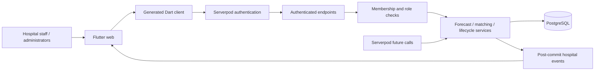

# BatchBeacon

**Predict shortages. Rescue surplus. Protect every batch.**

BatchBeacon coordinates hospital medicine supply through a Flutter web application, a Serverpod 4 backend, and PostgreSQL. It detects potential shortages, finds eligible exact-product surplus at another institution, protects the donor's own requirements, and records a pharmacist-approved transfer workflow.

[Hosted application](https://batchbeacon.serverpod.space/) · [Hosted API](https://batchbeacon.api.serverpod.space/)

This is an operational prototype. The demonstration uses fictional hospitals and products. Separate clean administrator workspaces contain no seeded operational data. All dispatch and receipt actions remain explicitly simulated; the software does not authorize physical medicine movement or make clinical decisions.

## Problem statement

One hospital can approach a stockout while another holds usable surplus. An inventory count alone does not establish that a batch can be shared: the donor still needs stock, expiry and storage conditions matter, product identity must match, and both institutions need authority to approve the exchange. Untracked requests and manual reconciliation also make it difficult to know whether stock is already reserved or whether a transfer actually changed the inventory ledger.

BatchBeacon addresses the coordination problem with demand-based estimates, conservative matching, separate approval responsibilities, transactional accounting, and an audit trail. It does not substitute medicines or infer clinical suitability.

## Solution and implemented features

- **Shortage forecasting:** recent consumption, usable unreserved inventory, expiry, policy horizon, and confirmed inbound supply determine estimated replenishment gaps.
- **Exact-product matching:** canonical SKU identity is mandatory. Expired, quarantined, unverified-storage and insufficient-shelf-life batches are rejected with explanations.
- **Donor protection:** sharing cannot consume the donor's projected demand and configured safety reserve.
- **Controlled transfers:** source and destination pharmacists approve independently before reservation. Simulated dispatch and receipt reconcile stock exactly once.
- **Live coordination:** authenticated, hospital-scoped Serverpod streams notify clients to reload committed state.
- **Operational input:** validated CSV inventory intake, daily consumption updates, and hospital-admin policy settings.
- **Account separation:** hospital membership and roles are enforced on the server. Clean workspaces and fictional demonstration organizations are separated in administration and product access.
- **Auditability:** proposals, approvals, reservations, transfer events, notifications and audit records persist in PostgreSQL.
- **Explanations:** Supply Investigator describes the deterministic calculation and rejection reasons. Gemini is not integrated; no AI-generated decision is claimed.

The web interface provides Dashboard, Inventory, Shortage Radar, Rescue Network, Transfers, Audit Trail and Settings. Navigation scrolls independently and Sign out remains pinned in short windows.

## Architecture



**Flutter** provides the responsive Material 3 interface, charts, typed forms, role-appropriate actions and browser session handling. The UI reads real endpoint results rather than manufacturing inventory, forecasts or successful transfers locally. Server events trigger a fresh authorized snapshot.

**Serverpod 4** owns the backend. `.spy.yaml` definitions generate the protocol, ORM types and Dart client; endpoint signatures remain type-safe across server and Flutter. Serverpod authentication supplies real identities and JWT validation. Endpoint streams support realtime updates, persisted future calls handle reservation expiry when enabled, and the web server serves the Flutter release bundle.

**PostgreSQL** stores the operational ledger. Mutations use a database transaction and a transaction-scoped advisory lock. Unique constraints and explicit state checks enforce proposal idempotency, stock reservation and once-only dispatch/receipt accounting. The global lock favors auditable prototype correctness over maximum throughput.

### Core data

| Area | Models |
|---|---|
| Organizations and authority | Hospital, HospitalUser, HospitalPolicy |
| Product and stock | Medicine, InventoryBatch, ConsumptionRecord, InboundSupply |
| Planning and coordination | ShortageForecast, RescueProposal, Approval, StockReservation |
| History and communication | TransferEvent, AuditEvent, Notification |

Authentication identities are managed by the Serverpod authentication module and mapped to active hospital memberships.

### Forecast and matching rules

1. Use previous complete UTC days, up to 30 days of observed consumption. The demand estimate is the greater of the observed 7-day and 30-day averages. Fewer than seven samples produces an insufficient-data result.
2. Count released, verified, unexpired stock; subtract reservations. Separate stock that remains usable through the forecast horizon.
3. Calculate an estimated gap against demand for the horizon plus safety-stock days, considering confirmed inbound within that horizon. An expiry-aware daily simulation checks early stockouts, so a late inbound delivery cannot conceal an earlier shortage.
4. For each exact-product donor batch, check quality, storage, expiry at arrival, category policy and the stricter remaining-shelf-life requirement.
5. Protect donor demand for its horizon plus safety-stock days. Bound a proposal by the recipient's gap and the batch's eligible unreserved surplus. Eligible candidates are ordered by expiry.

For the fictional starting scenario, Meridian has 35 units at 10 units/day: 3.5 days of cover and a 175-unit gap against a 21-day target. Northstar can share while retaining 84 units; Riverside needs to retain 252 units and has no safe surplus. These figures describe seeded test data, not real medicines or hospitals.

### Transfer lifecycle

```text
DRAFT -> PROPOSED -> PENDING_SOURCE_APPROVAL
      -> PENDING_DESTINATION_APPROVAL -> APPROVED -> RESERVED
      -> DISPATCHED_SIMULATED -> RECEIVED_SIMULATED
```

Rejection, cancellation and reservation expiry are separate terminal paths. Reservation does not reduce physical on-hand stock. Simulated dispatch reduces on-hand and reserved stock at the source; simulated receipt creates a provenance-linked destination batch. The server revalidates eligibility and enforces pharmacist authority at each relevant transition.

## Repository structure

```text
batchbeacon_server/
  lib/src/beacon/       Domain engine, endpoints, access checks and bootstrap
  lib/src/auth/         Serverpod authentication endpoints
  lib/src/generated/    Generated ORM, protocol and endpoint dispatch
  migrations/          Versioned PostgreSQL schema
  test/                Domain and database integration tests
batchbeacon_client/
  lib/                 Generated typed Dart client
  bin/                 Network verification utilities
batchbeacon_flutter/
  lib/                 Web UI, authentication and scrolling sidebar
  web/                 Web application shell and assets
  test/                Widget and responsive-layout tests
scripts/               Setup, build, launch and verification helpers
.github/workflows/     CI analysis, tests and release web build
```

Generated protocol code and migrations are committed because they are part of the runnable application. Caches, databases, passwords, Cloud CLI state, release bundles, screenshots, editor settings and private working/handoff documents are excluded. The README is the central project documentation; a separate demo guide is intentionally not checked in. Unused greeting examples and unvalidated native-platform scaffolds are omitted.

## Local setup

### Prerequisites

- Flutter with its bundled Dart SDK on PATH. Verified with Flutter **3.47.7** and Dart **3.13.5**; package constraints require Dart 3.12.2+ and Flutter 3.44.4+.
- Serverpod CLI **4.0.4** and Git.
- The implemented target is Flutter web. Android Studio, Xcode and native desktop toolchains are not needed.

Check installed versions before installing anything. Do not install a separate Dart SDK alongside Flutter.

```sh
flutter --version
dart --version
serverpod version
```

If the Serverpod CLI is missing:

```sh
dart install serverpod_cli@4.0.4
```

Ensure Dart's install executable directory is on PATH for new terminals. This differs from the older `dart pub global activate` executable directory.

### Clone and configure

```sh
git clone https://github.com/Manikant92/BatchBeacon.git
cd BatchBeacon
dart scripts/setup.dart
flutter pub get --enforce-lockfile
cd batchbeacon_server
serverpod generate
cd ..
```

`setup.dart` generates fresh development/test secrets in ignored `batchbeacon_server/config/passwords.yaml` and preserves an existing file. It never copies the original author's credentials. Local and test configuration use Serverpod-managed embedded PostgreSQL; no Docker daemon or standalone PostgreSQL installation is required. First use downloads the database binaries.

### Build and run

Windows PowerShell:

```powershell
.\scripts\build-web.ps1
serverpod start --no-watch --no-tui --no-flutter --no-docker
```

macOS/Linux:

```sh
cd batchbeacon_server
serverpod run flutter_build
cd ..
serverpod start --no-watch --no-tui --no-flutter --no-docker
```

Open **http://localhost:8082/**. The local API is **http://localhost:8080/**. For the normal development loop, `serverpod start` also handles code generation, migrations and the companion Flutter application.

Development data persists under `batchbeacon_server/.serverpod/`. On Windows, stop the local server before running server tests or operator seed/restore commands: native-asset build hooks may otherwise try to replace a loaded DLL.

## Authentication and data modes

| Role | Authority |
|---|---|
| Pharmacist | Own-hospital operations; approved-side transfer review, simulated dispatch/receipt |
| Inventory manager | Own-hospital inventory/consumption input; no pharmacist approval |
| Hospital administrator | Own-hospital operations and policy editing; no approval bypass |
| Platform administrator | Organizations and audit/status administration in its own data partition; no inherited detailed inventory access |

### Fictional demonstration

Development startup seeds Meridian General, Northstar Medical and Riverside Community idempotently. Choose Pharmacist or Inventory manager and enter hospital A, B or C. The buttons perform real server-side authentication for restricted fictional identities; they do not assign a role in the browser.

To exercise the workflow, request a rescue from Meridian, approve as Northstar in another browser profile, approve/reserve as Meridian, then simulate dispatch and receipt. Use separate profiles/private windows for simultaneous identities because tabs in one profile share cookies.

### Clean administrator workspace

Before starting the local server:

```sh
dart scripts/setup.dart --clean-admin
```

Startup creates **Hospital Workspace**, two real authentication accounts and initial policy configuration. It seeds no medicines, inventory, consumption, inbound supply, forecasts, transfers or audit history.

- Platform username: `platform.admin@batchbeacon.invalid`
- Hospital username: `hospital.admin@batchbeacon.invalid`

Read the corresponding private password from `.serverpod/clean_platform_password` or `.serverpod/clean_hospital_password` inside the server package. Use **Admin / institution sign-in**. Passwords are intentionally absent from this repository and are unique to each installation.

Clean platform access excludes fictional organizations. Clean hospital access excludes demo product intake and unrelated hospital operations. No real operational records are supplied by this repository. Catalog onboarding and authorized real data loading remain operator tasks.

### Seed and reset

From `batchbeacon_server`:

```sh
dart run bin/demo.dart seed
dart run bin/demo.dart restore
```

Seed preserves existing records. Restore is a deliberate reset of an isolated fictional database and removes its synthetic operational history. It refuses a mixed database containing a clean workspace or any unexpected organizations/products. Do not wipe a mixed database to reset a demonstration.

## Verification

Windows can run `scripts/verify.ps1`. The portable commands are:

```sh
dart format --output=none --set-exit-if-changed batchbeacon_server/lib batchbeacon_server/bin batchbeacon_server/test batchbeacon_client/bin batchbeacon_flutter/lib batchbeacon_flutter/test scripts/setup.dart
cd batchbeacon_server
dart analyze --fatal-infos
dart test --reporter expanded
cd ../batchbeacon_client
dart analyze --fatal-infos
cd ../batchbeacon_flutter
flutter analyze --no-pub --fatal-infos
flutter test --no-pub
flutter build web --release --no-pub
```

The server suite covers forecasting, exact matching, access isolation, role enforcement, transaction rollback, idempotent lifecycle accounting, reservation cancellation/expiry and a two-connection reservation race against PostgreSQL. Widget tests cover authentication, mobile layout, scrollable navigation and reachable Sign out in short windows. GitHub Actions runs the same analysis/test/build categories using fresh disposable secrets.

The publication checkout passed **34 server tests** (20 domain tests and 14 database integration tests) and **8 Flutter widget tests**. Server, client and Flutter analysis passed with fatal-info checks. The removed scaffold greeting test is not included in those totals.

With a running API, `batchbeacon_client/bin/smoke.dart` verifies a complete authenticated API/WebSocket rescue. It changes fictional operational state. `check_admin_access.dart` and `check_clean_access.dart` verify account scopes; they require the relevant private password files and never print passwords or tokens.

## Deployment with Serverpod Cloud

The hosted application uses Serverpod Cloud-managed PostgreSQL, HTTPS and platform-managed authentication/database secrets. `batchbeacon_server/scloud.yaml` identifies the existing `batchbeacon` deployment; use your own project ID for a separate installation. This configuration grants no access to the original Cloud account.

1. Build the Flutter web release into `batchbeacon_server/web/app` and regenerate server code using the local commands above.
2. Authenticate to Serverpod Cloud and create/select a project with PostgreSQL enabled.
3. Configure the exact browser origin and secure cookies through Cloud variables:

```sh
serverpod cloud --no-auto-cli-upgrade variable set SERVERPOD_AUTH_COOKIE_SECURE true
serverpod cloud --no-auto-cli-upgrade variable set SERVERPOD_ALLOWED_ORIGINS https://YOUR_PROJECT.serverpod.space
```

4. For an isolated public fictional demo, explicitly set `BATCHBEACON_DEMO=true` and supply a strong `demoAccountPassword` through encrypted password storage. Omit demo mode for a clean-only installation. To provision clean admins, supply `cleanPlatformAdminPassword` and `cleanHospitalAdminPassword`. Use `password set NAME --from-file PRIVATE_FILE`; do not embed passwords in source or shell history.
5. Deploy the prebuilt web bundle and server:

```sh
serverpod cloud --no-auto-cli-upgrade launch --project YOUR_PROJECT --no-pre-deploy-scripts
serverpod cloud --no-auto-cli-upgrade status deployment show
```

Cloud applies pending migrations before serving the application. Platform database/JWT/email secrets are managed by Cloud; local `passwords.yaml` is never uploaded. Cookie/origin settings must be configured as Cloud variables because Cloud supplies runtime configuration separately from local YAML.

The current hosted plan disables background future calls. The application checks that capability and releases overdue reservations during authorized reads/actions instead. Local scheduling remains enabled. A plan supporting future calls is required for expiry while the service is otherwise idle.

After deployment, verify login, hospital scope, persistent state and a complete transfer through the actual API. A successful build alone is not evidence that the workflow works.

## Limitations and next steps

- All transfer execution is simulated. Quality/storage/licensing checks are human-review placeholders, not compliance certification or prescribing advice.
- Forecasts are deterministic estimates without statistical calibration. Confirmed inbound lacks lot-level expiry; it is assumed usable upon arrival.
- Shared PubSub is not configured; cross-replica realtime delivery needs additional infrastructure. The global mutation lock limits throughput.
- Gemini integration, full user/catalog onboarding, partner contracts, pagination and native-platform builds are not implemented.
- CSV input supports the documented six unquoted fields without embedded commas. Pending unapproved proposals do not automatically expire.
- Clean credentials provide an empty, separated workspace; they do not supply real data or turn this prototype into a production medicine-distribution system.

Future work should prioritize authorized product/user onboarding, richer inbound lot data, calibrated forecasts, durable realtime delivery and independently validated institutional workflows.
